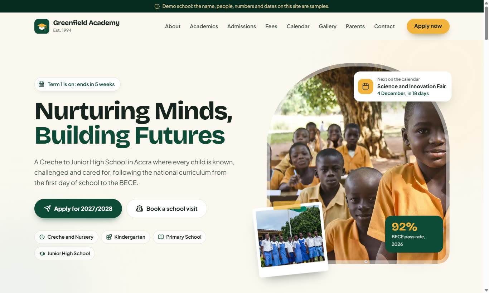
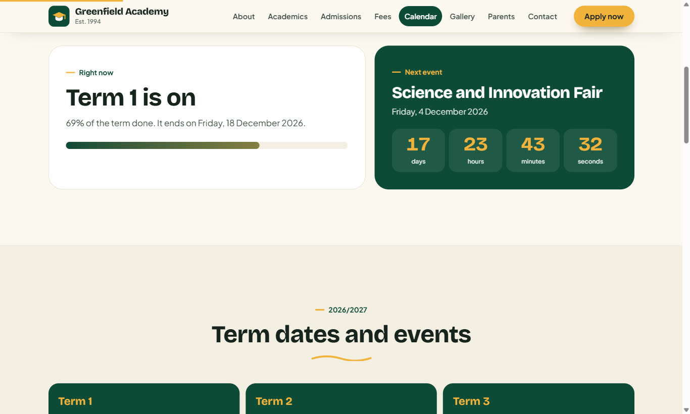
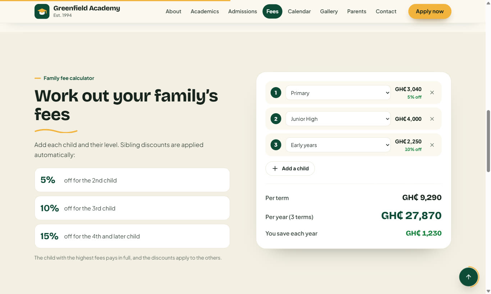
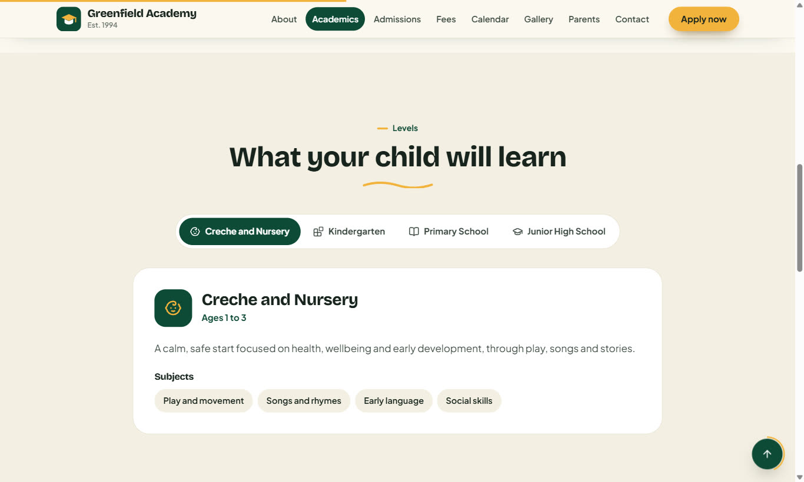
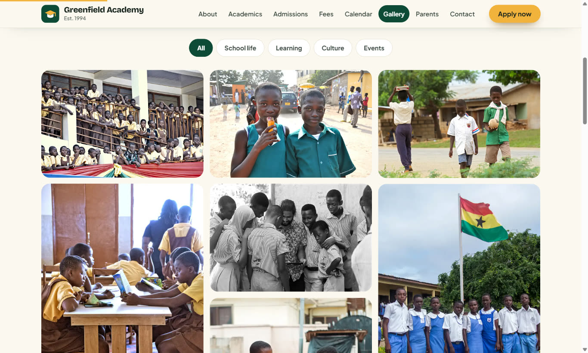
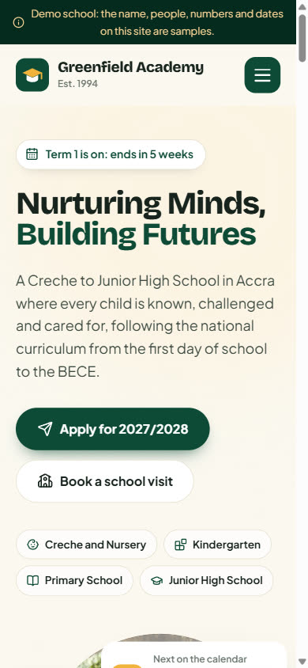
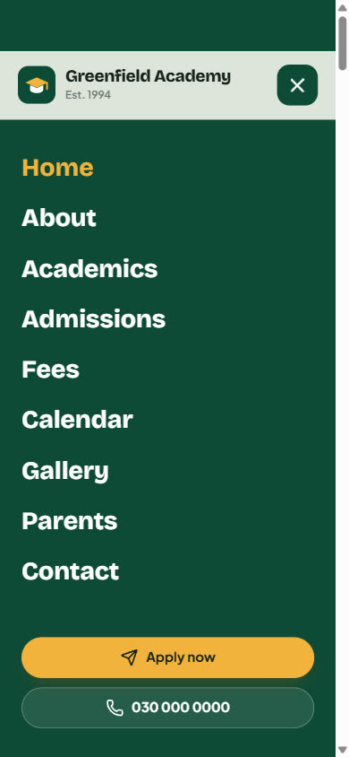

<div align="center">

# School website template

**A complete, fast website for a Ghanaian basic school (Creche to JHS), set up from one settings file.**

[**See the live demo**](https://ohenemanaf.github.io/schoolwebsite/): Greenfield Academy, a fictional school


</div>



| Live term status and countdown | Family fee calculator |
|---|---|
|  |  |

| Subjects for each level | Gallery with photo viewer |
|---|---|
|  |  |

| Phone | Phone menu |
|---|---|
|  |  |

## What a school gets

Nine pages: Home, About, Academics, Admissions, Fees, Calendar and news, Gallery, Parents, and Contact.

**Always up to date**
- **The term, at a glance.** For example "Term 1 is on: ends in 5 weeks", a progress bar for the term, and "Holidays: Term 2 starts in 18 days" between terms. It's all worked out from the term dates, so nothing needs editing as the weeks go by.
- **The next event.** A live countdown to the next event, and an "upcoming" list that drops dates once they've passed.
- **Term dates on parents' phones.** One tap adds every term date and event to their phone calendar, through a generated `calendar.ics` file.

**Built for parents**
- **Family fee calculator.** Add each child and their level. Sibling discounts (5%, 10%, 15%) are applied automatically, and it shows the total per term and per year.
- **Admissions.** Step-by-step guidance, entry requirements, and an online enquiry form.
- **Forms that arrive on WhatsApp.** The admission enquiry, absence report, feedback and contact forms open WhatsApp with the message written out for the school office. If the school has no WhatsApp, they open an email instead. There's no server to run.
- **Academics.** Each level has a tab listing its national-curriculum subjects, with direct links such as `curriculum.html#jhs`.
- **Gallery.** Category filters and a full-screen photo viewer with keyboard and swipe controls.
- **Phone bar.** Call, WhatsApp and Apply buttons stay at the bottom of the screen on phones.

**Design**
- **Scrapbook look.** Photos pinned like taped prints, hand-drawn underlines, and an arched hero photo with floating cards.
- **Motion.** Headings appear word by word, sections slide in, figures count up, notices scroll past, the history timeline fills in, and cards tilt. All of it turns off for visitors who choose "reduce motion".
- **Accessible.** It works with the keyboard and screen readers.

**Light**
- No frameworks or tracking.
- Fonts, icons and photos are all served from the site itself.
- Photos are compressed WebP files that load only as you scroll to them.

## Setting it up for a school

1. Copy this repository.
2. Edit **`school.config.mjs`**. Every setting is explained in the file:

   | Settings | What they change |
   |---|---|
   | `name`, `motto`, `intro`, `founded`, `logo` | The school's identity |
   | `brand`, `accent` | The school's two colours. Every other shade is worked out from them. |
   | `contact` | Phone, WhatsApp number, email, address, office hours |
   | `announcements`, `stats` | The notices strip and the figures on the home page |
   | `levels` | Each level with its ages, description and subjects |
   | `admissions` | Steps, requirements and the form fee |
   | `fees` | Fee plans per term, sibling discounts and ways to pay |
   | `calendar` | Term dates and events (written as `YYYY-MM-DD`) |
   | `news`, `gallery`, `staff`, `faqs`, `history`, `facilities` | The rest of the content |
   | `photos`, `photoCredits` | Which photo goes where, and who took it |

3. Put the school's own photos in `assets/photos/` (WebP or JPG, about 1100 px wide).
4. Build the site:
   ```
   node tools/build.mjs
   ```
   It writes the nine pages and `assets/calendar.ics`. You need [Node.js](https://nodejs.org) 20 or newer, and nothing else to install.

   The build checks the settings first. If something is wrong, it stops and says exactly what to fix:
   ```
   Cannot build the site:
     - Photo "sports.webp" has no entry in photoCredits.
     - Event "Sports day" has date "19/02/2027"; use YYYY-MM-DD.
   ```
5. Publish the folder on any static host: GitHub Pages, Netlify, Vercel or cPanel.

Run `npm test` to check the term, countdown and fee logic.

## Project layout

```
school.config.mjs      everything about the school (the only file to edit per school)
tools/build.mjs        builds the pages and the calendar file, and checks the settings first
assets/js/school.js    term status, countdowns and the fee calculator, used by the pages and the tests
assets/js/site.js      menu, scroll effects, tabs, calculator, forms, gallery viewer
assets/css/site.css    all styles; colours come from the two settings colours
assets/photos/         photos (WebP)
assets/icons.svg       icon set (Lucide)
assets/fonts/          Bricolage Grotesque and Plus Jakarta Sans
tests/                 run with: npm test
```

## Photo credits

The demo's photos show real schools in Ghana. They come from [Wikimedia Commons](https://commons.wikimedia.org) and are public domain, CC0 or CC BY 2.0. The full list, with each photographer and licence, is on the [gallery page](https://ohenemanaf.github.io/schoolwebsite/gallery.html#credits) and in `photoCredits` in the settings file.

Greenfield Academy, its staff, figures and dates are fictional.
